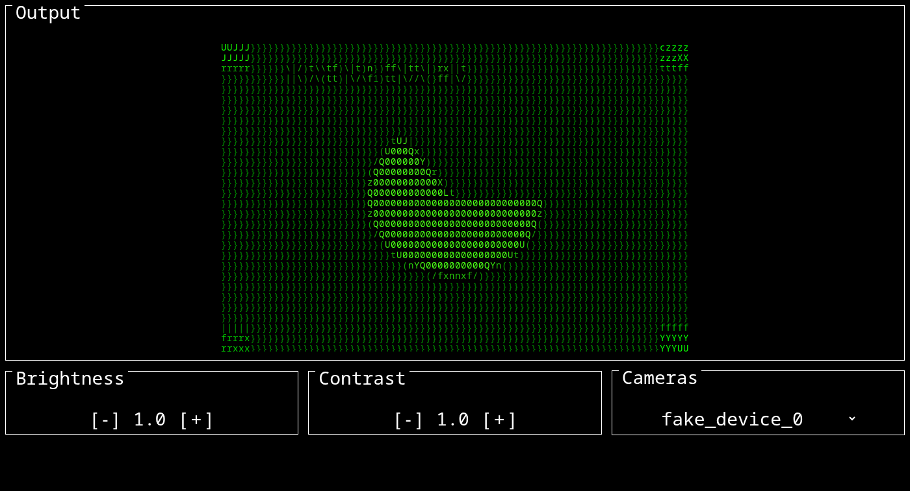

# wasm_ascii_cam

Live webcam video rendered as coloured ASCII art in the browser. The per-pixel work runs in Rust compiled to WebAssembly, spread across a pool of Web Workers.

**[Live demo](https://jake-king.github.io/wasm_ascii_cam/)**. Pick a camera from the menu. Video never leaves your machine; everything runs locally in the page.



## How it works

```
camera ─► <video> ─► 80×30 canvas ─► split into chunks ─► Web Workers (Rust/WASM) ─► reassemble ─► draw glyphs
          (brightness/contrast                              luma → palette index
           applied as a canvas filter)
```

1. Each animation frame, the camera image is scaled down to 80×30 pixels on a hidden canvas, with brightness and contrast applied as a canvas filter.
2. The RGBA pixels are split into whole-pixel chunks, one per CPU core, and sent to a pool of Web Workers.
3. Each worker runs `rgb_to_ascii` (Rust, [`src/lib.rs`](src/lib.rs)). It computes Rec. 601 luma for each pixel and maps it to one of 64 glyphs, from `.` (dark) to `$` (bright).
4. The main thread reassembles the chunks in order and draws each glyph in its source pixel's colour.

## Build and run

Requires Rust with the `wasm32-unknown-unknown` target, plus [wasm-pack](https://github.com/wasm-bindgen/wasm-pack).

```sh
rustup target add wasm32-unknown-unknown
cargo install wasm-pack

cargo test                                    # unit tests for the Rust core
wasm-pack build --release --target no-modules --no-typescript --out-dir www/pkg
python3 -m http.server --directory www 8000   # then open http://localhost:8000
```

Browsers only allow camera access on `https://` or `localhost`.

## Project layout

| Path | What it is |
|---|---|
| `src/lib.rs` | Pixel → glyph-index conversion, compiled to WebAssembly |
| `www/js/asciiCam.js` | Camera capture, frame chunking, and rendering |
| `www/js/thread.js` | Small Web Worker thread pool |
| `www/js/rgbToAscii.js` | Worker script that loads the WASM module |
| `.github/workflows/pages.yml` | Tests, builds and deploys to GitHub Pages |
