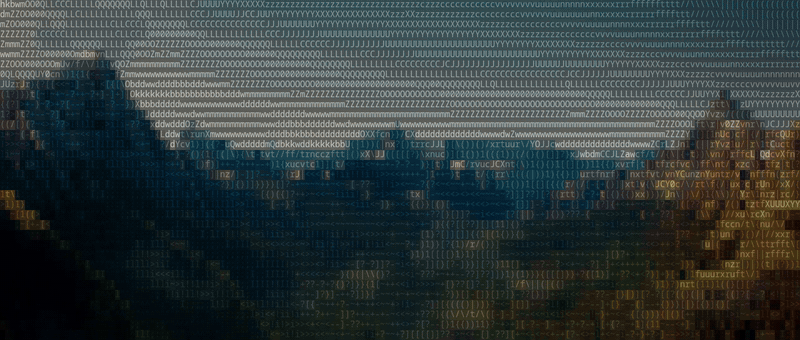

# wasm_ascii_cam

Live webcam video, or any video file, rendered as coloured ASCII art in the browser. The per-pixel work runs in Rust compiled to WebAssembly (with SIMD), spread across a pool of Web Workers, and the grid is drawn with WebGL2.

**[Live demo](https://jake-king.github.io/wasm_ascii_cam/)**. Allow camera access when asked, or open a video file under Controls. You can save a frame as PNG or text, or export a whole video as an ASCII WebM. Nothing leaves your machine; everything runs locally in the page.

The interface is styled after a curses terminal app: box-drawn windows, inverse title and key bars, and keyboard shortcuts.



<sub>Demo footage: [*Spring*](https://studio.blender.org/films/spring/) © Blender Foundation | cloud.blender.org/spring, licensed under [CC BY 4.0](https://creativecommons.org/licenses/by/4.0/). Changes: a 5-second excerpt, converted to ASCII by this app and encoded as a GIF.</sub>

## How it works

```
camera ─► <video> ─► grid-sized canvas ─► split into chunks ─► Web Workers (Rust/WASM) ─► reassemble ─► draw glyphs
          (brightness/contrast                              luma → palette index
           applied as a canvas filter)
```

1. Each animation frame, the camera image is cropped to the grid's shape, mirrored if enabled, and scaled down to one pixel per character (80×30, 120×45 or 160×60) on a hidden canvas, with brightness and contrast applied as a canvas filter.
2. The RGBA pixels are split into whole-pixel chunks, one per CPU core, and sent to a pool of Web Workers.
3. Each worker runs `rgb_to_ascii` (Rust, [`src/lib.rs`](src/lib.rs)). It computes Rec. 601 luma for each pixel and maps it to one of 64 glyphs, from `.` (dark) to `$` (bright), 16 pixels at a time with WebAssembly SIMD (below).
4. The main thread reassembles the chunks in order and draws each glyph in its source pixel's colour, or in phosphor green in Mono mode, with WebGL (below). With **Fill** on, each cell's background is shaded at 50% of its colour, which keeps colour vivid when the image is viewed small. With **Fit** on (the default for video files), the whole frame is shown with black bars instead of being cropped to the grid's shape. Frames are tagged with an id, so results from before a size or camera change are dropped.

## Rendering

Drawing 9,600 coloured characters with Canvas 2D `fillText` took most of each frame, so the grid is drawn with WebGL2 instead:

- The 64 glyphs are drawn once into an atlas texture, at a whole number of device pixels per cell.
- Each frame uploads two 160×60 textures: the glyph indices (from the WASM step) and the cell colours.
- One full-screen triangle is drawn. The fragment shader works out which cell each pixel is in, then looks up that cell's glyph in the atlas and its colour.

That is one draw call per frame and no per-cell JavaScript. Canvas 2D remains as a fallback when WebGL2 is unavailable, and can be forced with `?renderer=2d`.

Measured with [`www/bench.html`](www/bench.html): random 160×60 frames (every cell a different colour, the worst case), waiting for each frame to finish drawing, including GPU work.

| Browser | Renderer | Colour | Mono |
|---|---|---|---|
| Chromium 154 | Canvas 2D | 72.8 ms | 11.2 ms |
| Chromium 154 | WebGL2 | 0.15 ms | 0.14 ms |
| Firefox 157 | Canvas 2D | 14.7 ms | 9.8 ms |
| Firefox 157 | WebGL2 | 0.12 ms | 0.09 ms |

Intel i5-12600KF, NVIDIA RTX 5060 Ti, Linux. At 60 fps a frame has 16.7 ms, so Canvas 2D used most or all of it; WebGL2 uses under 1%. The WASM conversion step takes about 0.01 ms per frame.

## SIMD

The conversion has a WebAssembly SIMD path, [`simd::rgb_to_ascii_16`](src/lib.rs), that handles 16 pixels per step. For each 128-bit vector of 4 RGBA pixels it widens the bytes to 16 bits, then `i32x4.dot_i16x8_s` multiplies by the luma weights and adds neighbouring pairs, giving (77 R + 150 G) and (29 B + 0 A) per pixel. Adding the two halves and shifting right by 10 gives the palette index directly (luma `>> 8`, then 256 → 64 levels `>> 2`). Four results are narrowed back to 16 bytes and stored.

Two builds ship: `www/pkg` (scalar) and `www/pkg-simd`. Each worker asks the browser whether it can compile the SIMD build (`WebAssembly.validate`) and falls back to the scalar one if not. The status bar shows which is in use.

Correctness: `npm test` checks the SIMD build against the scalar build for **all 16.7 million RGB colours** and for every input length from 0 to 50 pixels, so the 16-pixel groups and the leftover tail are both covered.

Speed (`npm run bench`, Node 22, Intel i5-12600KF):

| Frame | Measured | Scalar | SIMD | Speed-up |
|---|---|---|---|---|
| 160×60 | conversion only (inside WASM) | 0.006 ms | 0.004 ms | 1.7× |
| 160×60 | with JS↔WASM copies | 0.008 ms | 0.005 ms | 1.6× |
| 1920×1080 | conversion only (inside WASM) | 1.394 ms | 0.837 ms | 1.7× |
| 1920×1080 | with JS↔WASM copies | 2.118 ms | 1.506 ms | 1.4× |

At 160×60 the conversion was already about 0.01 ms per frame, so SIMD does not change the frame rate; drawing was the bottleneck, which is what the WebGL renderer fixed.

## Video files and export

Open a video file to use it as the source instead of the camera. It plays looped, with sound, and can be paused and scrubbed. The file is read through an object URL; it is never uploaded.

**Export** plays the clip from the start and records the rendered grid, plus the file's sound, with `MediaRecorder` (`canvas.captureStream` + the video element's audio track) into a WebM. Export runs in real time, so a 1-minute clip takes 1 minute.

Known limitation: browsers write recorded WebM files without a duration in the header. They play normally, but some players cannot show the length or seek.

## Controls

| Key | Action |
|---|---|
| `1` `2` `3` | Detail: 80×30, 120×45, 160×60 |
| `b` / `B` | Brightness down / up |
| `c` / `C` | Contrast down / up |
| `r` | Reset brightness and contrast |
| `m` | Mirror on/off |
| `g` | Mono (green) on/off |
| `f` | Fill: shade each cell's background with its colour |
| `w` | Fit: show the whole frame with black bars, instead of cropping (on for video files) |
| `s` / `t` | Save the current frame as PNG / text |
| `o` | Open a video file |
| `space` | Pause / play the video |
| `←` / `→` | Seek the video 5 s back / forward |

## Build and run

Requires Rust with the `wasm32-unknown-unknown` target, plus [wasm-pack](https://github.com/wasm-bindgen/wasm-pack).

```sh
rustup target add wasm32-unknown-unknown
cargo install wasm-pack

cargo test        # unit tests for the Rust core
npm run build     # both WebAssembly builds: www/pkg and www/pkg-simd
npm test          # chunking tests + SIMD-vs-scalar equivalence (Node 22+)
npm run bench     # SIMD vs scalar timings
python3 serve.py  # then open http://localhost:8000
```

Browsers only allow camera access on `https://` or `localhost`. `serve.py` disables caching, so a reload always runs the current code.

## Project layout

| Path | What it is |
|---|---|
| `src/lib.rs` | Pixel → glyph-index conversion, scalar and SIMD, compiled to WebAssembly |
| `www/js/asciiCam.js` | Camera and video-file sources, cropping, frame scheduling, snapshot and export |
| `www/js/renderer.js` | WebGL2 renderer (glyph atlas + fragment shader) and Canvas 2D fallback |
| `www/js/chunks.js` | Splits a frame into whole-pixel chunks, one per worker |
| `www/js/script.js` | Controls, keyboard shortcuts, and status bar |
| `www/js/thread.js` | Small Web Worker thread pool |
| `www/js/rgbToAscii.js` | Worker script: loads the SIMD build if supported, else scalar |
| `www/bench.html` | Renderer benchmark |
| `test/` | Node tests: chunking, and SIMD vs scalar for every colour |
| `bench/convert.mjs` | SIMD vs scalar benchmark |
| `.github/workflows/pages.yml` | Tests, builds and deploys to GitHub Pages |

## License

[MIT](LICENSE)
